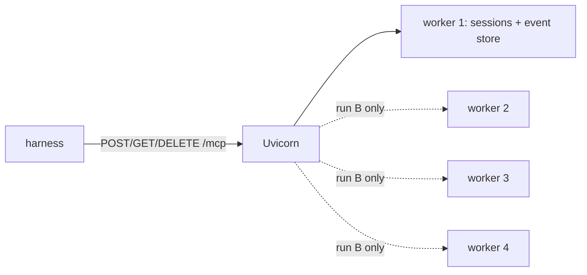

# 02 — Streamable HTTP, single replica

The standard tool set over Streamable HTTP. Run A is one Uvicorn worker (the baseline). Run B is
four workers in one container, which breaks sessions because each worker keeps its own in memory.



## Layout
| File | Contents |
|---|---|
| `src/mcpserver/app.py` | `create_mcp_server()`, `create_asgi_app()` (Uvicorn factory), `/healthz` |
| `src/mcpserver/event_store.py` | `InMemoryEventStore` (SDK `EventStore`) for `Last-Event-ID` resume |
| `src/mcpserver/tracing.py` | optional OTLP tracing, span tagged with `mcp.session_id` |
| `src/mcpserver/__main__.py` | Uvicorn with `MCP_WORKER_COUNT` workers |
| `harness/single-worker.env` / `four-workers.env` | harness expectations for run A / B |
| `results/` | distribution and Locust reports |

## Run
```powershell
python -m venv .venv; .\.venv\Scripts\python.exe -m pip install -e ".[dev]"
.\.venv\Scripts\python.exe -m pytest                       # unit tests

docker compose up -d --build                               # run A (1 worker)
# run B: $env:MCP_WORKER_COUNT="4"; docker compose up -d

cd ..\test-harness
$env:HARNESS_ENV_FILE="../02-streamable-http-single/harness/single-worker.env"   # or four-workers.env
.\.venv\Scripts\python.exe -m pytest tests/suites -rxXs
.\.venv\Scripts\locust.exe -f load/locustfile.py --headless --only-summary --csv ../02-streamable-http-single/results/single-worker/load
```
Tracing: start `../compose.observability.yaml` and set
`MCP_OTEL_EXPORTER_ENDPOINT=http://host.docker.internal:4318` before `docker compose up`.

## Results (2026-10-06)
**Unit tests:** 20 passed, coverage 98%, ruff clean.

**Harness suites**
| Suite | Run A (1 worker) | Run B (4 workers) |
|---|---|---|
| conformance (6 checks) | ✅ | ⚠ random — each check passes or fails depending on which worker gets each connection |
| distribution | ✅ (1 unit) | ❌ every run (sessions break before 30 complete) |
| session affinity (200 calls) | ✅ | ❌ every run (`404 Session terminated`) |
| resumability | ✅ | ⚠ random |
| elicitation | ✅ | ⚠ random |
| failover | — | — |

Run B's settings mark affinity and distribution as expected failures and skip the random suites,
so the run is repeatable (`3 xfailed, 9 skipped`).

**Load (short profile: 5 → 20 → 40 users, ~1 min)**
| Run | Requests | Failures | `get_replica_id` p50 / p95 | Spread |
|---|---|---|---|---|
| A | 706 | 0 | 57 / 69 ms | 1 worker |
| B | 731 | 12 (all `DELETE`) | 54 / 99 ms | 22–29% per worker |

## Findings
- **Load tests hide the multi-worker bug.** Each Locust user sends requests one at a time on one
  keep-alive connection, and a connection stays on one worker, so its whole session happens to stay
  there. The SDK client opens several connections (POSTs plus a background GET stream) and breaks
  within a few calls. Test with real clients, not only with load tools.
- `DELETE` failed 30% in run B: it is sent on a fresh connection after the user's last call.

## When to use in production
One replica, one worker: small internal servers where a restart losing sessions is acceptable.
Never run a stateful MCP server with several Uvicorn/Gunicorn workers behind one port.
