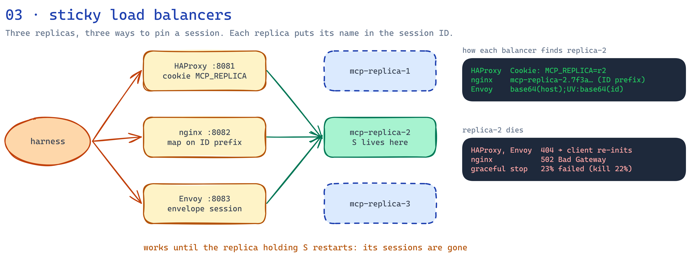

# 03 — Sticky-session load balancers

Three stateful replicas behind three load balancers, each pinning a session to its replica in a
different way. Every replica issues session IDs prefixed with its name (`mcp-replica-2.<uuid>`).



Editable source: [docs/architecture.excalidraw](docs/architecture.excalidraw).

```mermaid
sequenceDiagram
    participant C as Client
    participant LB as Load balancer
    participant R2 as mcp-replica-2
    C->>LB: POST initialize (no session id)
    LB->>R2: round robin
    R2-->>LB: mcp-session-id: mcp-replica-2.7f3a…
    LB-->>C: A: + Set-Cookie MCP_REPLICA=r2 / B: unchanged / C: base64(host);UV:base64(id)
    C->>LB: POST tools/call (cookie or session id)
    LB->>R2: A: cookie / B: prefix map / C: decoded host
    R2-->>C: result
```

## Layout
| File | Contents |
|---|---|
| `src/mcpserver/session_id_generator.py` | `ReplicaPrefixedSessionManager` and `install_replica_prefixed_session_manager()` |
| `infra/haproxy.cfg` | variant A: `cookie MCP_REPLICA insert`, health checks, `option redispatch` |
| `infra/nginx.conf` | variant B: `map $http_mcp_session_id` → per-replica upstreams, `resolve` for restarts |
| `infra/envoy.yaml` | variant C: `envelope` stateful session on `mcp-session-id`, health checks, outlier detection, retry only on connect failure, no route timeout |
| `harness/*.env` | harness expectations per load balancer |
| `results/` | JUnit reports, distribution and Locust reports, restart experiment |
| `docs/` | architecture diagram: `architecture.png` and its editable `architecture.excalidraw` |

The SDK (mcp 1.30) has no public hook for session ID generation, so the manager overrides the
private `_admit_session` and is installed through FastMCP's `_session_manager`. The version is
pinned, and `tests/test_session_id_generator.py` fails if an upgrade breaks it.

## Run
```powershell
python -m venv .venv; .\.venv\Scripts\python.exe -m pip install -e ".[dev]"
.\.venv\Scripts\python.exe -m pytest                       # unit tests
docker compose up -d --build                               # 3 replicas + 3 load balancers

cd ..\test-harness
$env:HARNESS_ENV_FILE="../03-sticky-session-lb/harness/cookie-haproxy.env"   # prefix-nginx / envelope-envoy
.\.venv\Scripts\python.exe -m pytest tests/suites -rxX
.\.venv\Scripts\locust.exe -f load/locustfile.py --headless --only-summary --csv ../03-sticky-session-lb/results/cookie-haproxy/load
```
The failover suite runs `docker kill <replica>` and then `docker start <replica>`.

## Results (2026-10-06)
**Unit tests:** 22 passed, coverage 97%, ruff clean.

**Harness suites:** every load balancer: `11 passed, 1 xfailed` (failover is the expected failure).

| | A: HAProxy cookie | B: nginx prefix | C: Envoy envelope |
|---|---|---|---|
| conformance, elicitation, resumability | ✅ | ✅ | ✅ |
| affinity (1,000 calls, one replica) | ✅ | ✅ | ✅ |
| distribution of 30 new sessions | ✅ | ✅ | ✅ |
| failover: client sees | `404` → `Session terminated` | `502 Bad Gateway` | `404` → `Session terminated` |
| load: requests / failures | 1,234 / 0 | 1,270 / 0 | 1,237 / 0 |
| load: `get_replica_id` p50 / p95 / p99 | 55 / 68 / 75 ms | 55 / 68 / 86 ms | 55 / 67 / 73 ms |
| load: share per replica | 34 / 32 / 34% | 35 / 34 / 32% | 27 / 42 / 31% |

Load used the short profile (5 → 30 → 60 users, ~50 s). Full profile: unset the
`HARNESS_LOAD_*` overrides.


**Restart under load** (HAProxy, 30 users, `mcp-replica-1` restarted at 25 s)
| Restart | Requests | Failures | Failure types |
|---|---|---|---|
| graceful `docker stop` (took 1.0 s) | 1,477 | 337 (23%) | 335 × `404`, 2 × connection cut |
| hard `docker kill` | 1,488 | 332 (22%) | 332 × `404` |

## Findings
- **Failover loses the session with every variant**; only the error differs. A `404` tells an MCP
  client to start a new session (spec behaviour); nginx's `502` looks like an outage, because the
  prefix pins the request to the dead upstream with no fallback.
- **Graceful drain made no difference.** The ~third of users pinned to the restarted replica got
  `404` on every later call. Uvicorn stopped in 1 s and cut 2 in-flight slow jobs. The planned
  acceptance criterion ("drain cuts dropped sessions") is **not met**: draining in-flight requests
  can't save sessions held in memory.
- **Resume race behind HAProxy.** HAProxy closes the upstream connection a few ms after the
  client leaves. A resume (`GET` + `Last-Event-ID`) that arrives in that window gets only the missed
  events, then the stream ends. Clients must reconnect again with the latest event ID; the harness
  does this (`HARNESS_RESUMABILITY_MAX_RECONNECTS`).
- **Cookies work with the Python SDK client** (httpx keeps them per client). Clients that drop
  cookies would lose affinity with variant A.
- **Envoy envelope** needs no server change and is transparent to clients, but spread new
  sessions least evenly here.

## When to use in production
Stateful MCP servers (elicitation, progress streams, resumability) that need more than one replica,
where losing sessions on a replica restart is acceptable. Prefer a variant that answers `404` on
failover (HAProxy cookie, or Envoy envelope when clients may drop cookies).
