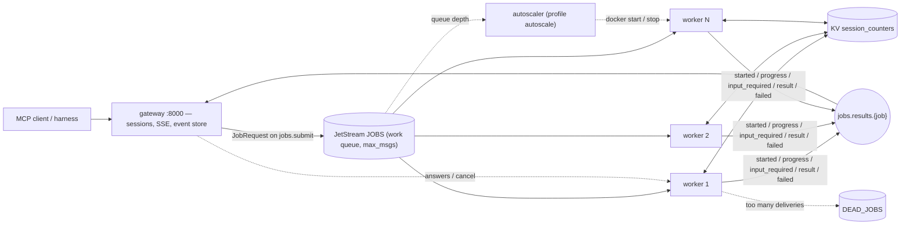
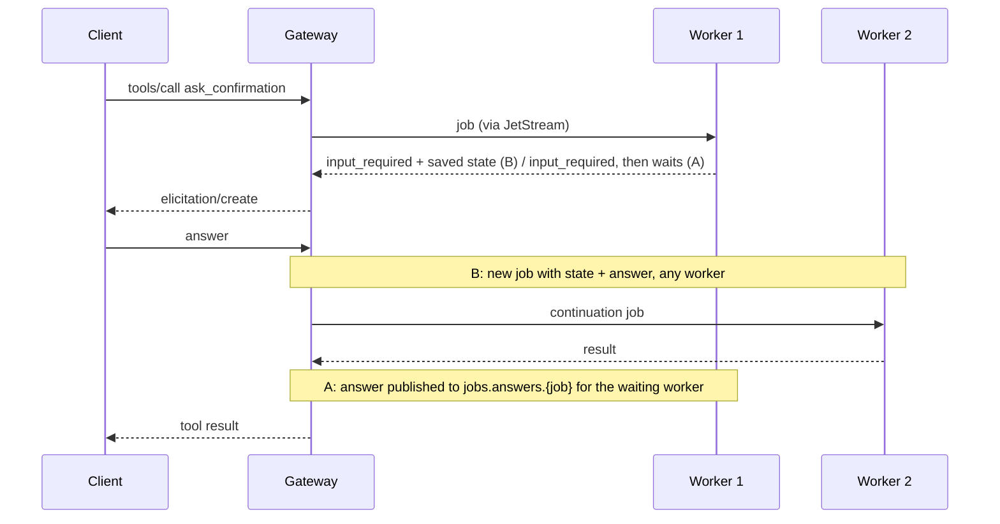

# 04 — Gateway + queue + workers

One MCP gateway holds every client session and stream. Each tool call becomes a job on a NATS
JetStream work queue; a pool of workers runs the tool code. Per-session state lives in a NATS
key-value bucket, so any worker can serve any call. An optional autoscaler starts and stops
worker containers based on queue depth.





## Layout
| Path | Contents |
|---|---|
| `src/mcpqueue/job_messages.py` | `JobRequest`, `JobStarted`/`JobProgress`/`JobInputRequired`/`JobResult`/`JobFailed`, subjects |
| `src/mcpqueue/nats_client.py` | connection; JOBS + DEAD_JOBS streams, durable consumer, KV bucket |
| `src/mcpqueue/gateway/` | `app.py`, `gateway_tools.py`, `job_runner.py` (relays worker messages to MCP), `job_bus.py` (NATS), `event_store.py` |
| `src/mcpqueue/worker/` | `job_consumer.py` (fetch, heartbeat, cancel, ack/term, dead letters), `tool_handlers.py`, `session_counters.py` (KV compare-and-set) |
| `src/mcpqueue/autoscaler/` | `scaling_policy.py`, `scaling_loop.py`, `queue_depth_monitor.py`, `worker_scaler.py` (Docker SDK) |
| `tests/unit/` | gateway, worker, autoscaler, messages, event store — with fakes, no Docker |
| `tests/integration/` | throughput, redelivery, cancel, backpressure, elicitation under failure, autoscaling — drives the Compose stack |
| `harness/gateway.env` | harness expectations |

## Design choices
- **One job at a time per worker**, with a heartbeat (`in_progress`) every second, so JetStream
  only redelivers a job when its worker really died (`MCP_JOB_ACK_WAIT_SECONDS`).
- **Results go once.** The gateway returns the first `JobResult`; progress is forwarded only when
  it increases, so a redelivered job doesn't restart the client's progress bar.
- **Idempotent counter.** The KV record stores the last job ID; a redelivered increment returns
  the stored value instead of adding again.
- **Cancel:** a cancelled `tools/call` publishes `jobs.cancel.<job>`; the worker stops and
  terminates the job (no redelivery).
- **Backpressure:** the JOBS stream has `max_msgs` and discards new messages when full; the gateway
  turns the publish error into a tool error "job queue is full; retry later".
- **Dead letters:** the consumer allows one extra delivery; a worker that sees it moves the job to
  `DEAD_JOBS` and reports failure instead of running it again.
- **Elicitation:** `MCP_ELICITATION_MODE=worker_waits` (A) or `continuation` (B, default).
- **Autoscaler:** Compose creates the maximum number of workers; the autoscaler starts/stops them
  (scale up at once, scale down after a cooldown).
- **MCP Tasks not used:** they are experimental in the 2025-11-25 spec and the SDK 1.30 client API
  is deprecated. Long jobs stream progress and can be cancelled instead.

## Run
```powershell
python -m venv .venv; .\.venv\Scripts\python.exe -m pip install -e ".[dev]"
.\.venv\Scripts\python.exe -m pytest                         # 40 unit tests, coverage gate 80%

docker compose up -d --build --wait                          # nats, gateway, 3 workers
.\.venv\Scripts\python.exe -m pytest tests/integration -m integration --no-cov   # ~4 min

cd ..\test-harness
$env:HARNESS_ENV_FILE="../04-gateway-queue-workers/harness/gateway.env"
.\.venv\Scripts\python.exe -m pytest tests/suites -rxX

# Autoscaling: create 10 workers and let the autoscaler manage them
$env:WORKER_REPLICAS="10"; docker compose --profile autoscale up -d --wait
```
Coverage omits the NATS/Docker adapters (`nats_client.py`, `job_bus.py`, `job_consumer.py`,
`queue_depth_monitor.py`, `worker_scaler.py`); the integration tests exercise them.

## Results (2026-10-08)
**Unit tests:** 40 passed, coverage 98%, ruff clean. **Integration:** 7 passed.

**Harness suites** (3 workers): `11 passed, 1 xfailed`
| Suite | Result |
|---|---|
| conformance, distribution (10/10/10 across workers), elicitation, resumability | ✅ |
| affinity (1,000 increments) | ✅ — counter in KV |
| failover (kill the worker that served the session) | ✅ — counter continues |
| pinning (one serving unit per session) | ❌ expected — calls go to any free worker |

**Integration tests**
| Check | Result |
|---|---|
| Throughput, 10 × `run_slow_job(2)` | 1 worker 21.2 s · 5 workers 5.2 s · 10 workers 3.6 s |
| Worker killed during `run_slow_job(6)` | redelivered to the other worker (attempts 1, 2); client progress 1…6 with no repeats; one result |
| Cancel after first progress, 1 worker | next call answered in 0.08 s (the 30 s job stopped) |
| 10 calls, queue limit 3, 1 worker | 3 succeeded, 7 rejected with "queue is full" |
| Elicitation, asking worker killed while user thinks — A `worker_waits` | user asked **twice** (redelivery re-asks), 5.4 s |
| — B `continuation` | user asked **once**, 1.6 s |
| Autoscaler, 30 × `run_slow_job(4)`, min 1 / max 10 | 1 → 10 workers in ~5 s, 30/30 succeeded, back to 1 after cooldown |

**Load (short profile, 3 workers):** 569 requests, 0 failures; `get_replica_id` p50 / p95
1.6 s / 3.8 s (phase 3: 55 / 68 ms).

## Findings
- **State survives worker loss.** First pattern where killing the process that served a session
  doesn't reset it.
- **Head-of-line blocking.** With one job per worker, quick calls wait behind 2 s slow jobs: p50
  rose from 55 ms to 1.6 s at the same load. Fixes: more workers (the autoscaler), several jobs per
  worker, or a separate queue for slow tools.
- **Variant B is the better elicitation design:** no worker sits idle while the user thinks, and a
  worker crash costs nothing. Variant A re-asks the user after a redelivery.
- **NATS `drain()` hung on shutdown** with an open pull subscription, so `docker stop` waited for
  the 15 s kill. Using `close()` stops a worker in under 2 s.
- **The gateway is now the single point of failure:** sessions and streams live in its memory.

## When to use in production
Tools that are slow, CPU-heavy or need retries, where compute should scale separately from
connections. Keep the gateway thin; add a second gateway only with session routing (phase 3
techniques) or the stateless 2026 spec.
