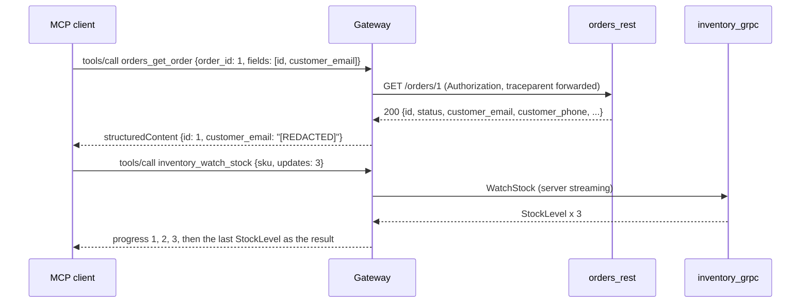

# 05 — API-to-MCP gateway (Part B)

Exposes existing REST and gRPC services as MCP tools without changing them, modelled on Uber's MCP
Gateway. A control plane discovers operations (OpenAPI for REST, server reflection for gRPC) and
keeps every tool **disabled until a reviewed override enables it**. A data plane translates calls
both ways, filters results, and also serves **MCP tools as REST** (the reverse direction).


Editable source: [docs/architecture.excalidraw](docs/architecture.excalidraw).



## Layout
| Path | Contents |
|---|---|
| `backends/orders_rest/` | FastAPI orders service (own venv/Dockerfile): get, list, create, cancel, `/caller` echoes headers |
| `backends/inventory_grpc/` | gRPC inventory service with reflection; `proto/inventory/v1/inventory.proto` (int64, enum, Timestamp, oneof, repeated, map, server streaming) |
| `config/services.yaml` | which backends to crawl |
| `config/tool_overrides.yaml` | which tools are enabled, with reviewed descriptions |
| `src/apigateway/openapi_tool_builder.py` | OpenAPI → tools: `$ref` inlining, path/query/header/body placement, array results wrapped |
| `src/apigateway/grpc_tool_builder.py` | reflection → tools: proto3 JSON mapping to JSON Schema |
| `src/apigateway/tool_registry.py` | curation (disabled by default), periodic reload, `/registry` listing |
| `src/apigateway/tool_router.py` | input validation, retries for read-only tools, result building |
| `src/apigateway/rest_invoker.py`, `grpc_invoker.py`, `error_mapping.py`, `response_filters.py` | translation, errors, projection + PII redaction |
| `src/apigateway/discovery_tools.py` | many-tools mode: `search_tools`, `get_tool_schema`, `invoke_tool` |
| `src/apigateway/mcp_server.py`, `rest_facade.py`, `app.py` | MCP endpoint, REST facade + generated OpenAPI, app wiring |
| `tests/` | 56 unit tests: golden snapshots, respx, in-process gRPC server compiled from the real `.proto` |
| `tests/integration/` | 8 tests against the Compose stack, incl. Schemathesis fuzzing of the facade |
| `load/locustfile.py` | direct REST vs through the gateway |
| `comparisons/fastmcp_from_openapi/` | same OpenAPI document through `FastMCP.from_openapi` |
| `docs/` | architecture diagram: `architecture.png` and its editable `architecture.excalidraw` |

## Design choices
- **Tool names** are `<service>_<operation in snake_case>` (`getOrder` → `orders_get_order`).
- **Errors:** unknown or disabled tool → JSON-RPC error `-32602`. Arguments that fail the schema
  and backend errors (HTTP 4xx/5xx, gRPC status, connection failures) → `isError` tool results the
  model can act on (the 2025-11-25 spec asks for input-validation errors as tool errors). Retryable
  failures (503, `UNAVAILABLE`, timeouts) say so, and are retried only for read-only tools.
- **Output schemas** drop `required`, so a `fields` projection still validates; non-object
  results (lists) are wrapped in `result`.
- **gRPC JSON** follows the proto3 mapping: camelCase names, `int64` as string (integer accepted),
  enum names, RFC 3339 timestamps, `oneof` as "at most one of".
- **Own `tools/call` handler** on the low-level server: the SDK's `@call_tool` decorator turns
  every exception into a tool result, which would hide unknown-tool errors.
- **Facade** is an MCP client: it can sit in front of any MCP server (`MCP_FACADE_UPSTREAM_URL`),
  here the gateway itself. One MCP session per REST request.
- **LLM-written descriptions** (optional in the plan) are not built; descriptions come from the
  OpenAPI summary or the overrides file.

## Run
```powershell
# backends (each has its own venv)
cd backends\orders_rest; python -m venv .venv; .\.venv\Scripts\python.exe -m pip install -e ".[dev]"; .\.venv\Scripts\python.exe -m pytest; cd ..\..
cd backends\inventory_grpc; python -m venv .venv; .\.venv\Scripts\python.exe -m pip install grpcio-tools
.\.venv\Scripts\python.exe -m grpc_tools.protoc -I proto --python_out=src --grpc_python_out=src proto/inventory/v1/inventory.proto
.\.venv\Scripts\python.exe -m pip install -e ".[dev]"; .\.venv\Scripts\python.exe -m pytest; cd ..\..

# gateway
python -m venv .venv; .\.venv\Scripts\python.exe -m pip install -e ".[dev]"
.\.venv\Scripts\python.exe -m pytest                                  # unit tests
docker compose up -d --build --wait                                   # orders, inventory, gateway
.\.venv\Scripts\python.exe -m pytest tests/integration -m integration --no-cov
curl http://localhost:8000/registry                                   # what was discovered
.\.venv\Scripts\locust.exe -f load/locustfile.py --headless -u 20 -r 5 -t 45s GatewayOrdersUser
```
Regenerate golden files after an intended change: `$env:UPDATE_SNAPSHOTS="1"; pytest`.
Enable a tool: set `enabled: true` in `config/tool_overrides.yaml`; it appears within one refresh.

## Results (2026-10-08)
| Check | Result |
|---|---|
| Unit tests | gateway 56 passed (97% coverage); orders backend 7; inventory backend 4 |
| Discovery | 5 REST + 3 gRPC operations found; 7 enabled, `orders_cancel_order` held back |
| REST translation | path/query/body placement, 404 → `isError` "backend returned HTTP 404: order 999 not found" |
| gRPC translation | `available` "3" (int64 as string), status `LOW_STOCK`, NOT_FOUND / FAILED_PRECONDITION mapped |
| Streaming | `WatchStock` → progress 1, 2, 3, last update as result |
| Filters | `customer_email` / `customer_phone` → `[REDACTED]`; `fields` keeps only the requested keys |
| Header pass-through | `Authorization` and `traceparent` reach the backend via MCP and via the facade |
| Curation reload | enabling `orders_cancel_order` took effect in 4.8 s, disabling in 4.8 s (refresh 5 s), no restart |
| Facade | same result as MCP; **Schemathesis: 483 generated cases passed** |
| Harness protocol checks | 3/3 (400 without session, 404 unknown session, 404 after DELETE) |

**Overhead** (20 users, 45 s, `GET /orders/1`)
| Path | p50 | p95 | p99 | req/s | failures |
|---|---|---|---|---|---|
| Direct REST | 7 ms | 12 ms | 14 ms | 91.7 | 0 |
| Gateway, first version | 71 ms | 380 ms | 600 ms | 62.0 | 0 |
| Gateway, compiled validators | 59 ms | 75 ms | 95 ms | 73.0 | 0 |


**FastMCP.from_openapi** (fastmcp 4.0.11 on mcp 2.3.0, report in `results/comparison/`)
| | FastMCP.from_openapi | This gateway |
|---|---|---|
| Tools from the orders spec | all 5, named by `operationId` (`getOrder`) | 5 discovered, 4 enabled after review, `orders_get_order` |
| Curation | none by default (route maps can exclude) | disabled until enabled in overrides, live reload |
| PII in results | returned as-is (`ana@example.com`) | redacted |
| `fields` projection | no | yes |
| 404 | `isError`, "HTTP error 404: Not Found - {...}" | `isError`, "backend returned HTTP 404: order 999 not found" |
| gRPC, REST facade, retries | no | yes |

## Findings
- **Schemathesis found two real facade bugs** (`junit-before-fixes-10-failures.xml`): a body that
  is not valid UTF-8 caused a 500, and an empty projection `{}` was returned as the string `"{}"`
  because `{}` is falsy. Both fixed with regression tests; the rerun passed 483 cases.
- **`jsonschema.validate()` per call was the main overhead**: it re-checks the schema every time.
  Compiling each tool's validator once cut p95 from 380 ms to 75 ms.
- **~50 ms per call remains** over direct REST: an MCP session lookup and an SSE response per call
  in the SDK's Streamable HTTP transport. Worth measuring `json_response` mode next.
- **One `.proto`, three uses:** the backend's generated code, the gateway tests (compiled at test
  time into a descriptor pool for an in-process server with reflection), and the gateway at runtime
  (reflection). The gateway never needs the `.proto` file itself.
- **`FastMCP.from_openapi` is the quick path** when every endpoint may be exposed as-is; curation,
  redaction and projection are what make a gateway safe for agents.

## When to use in production
An organisation with many existing services that agents should use: one gateway, reviewed tool
curation, central auth pass-through, redaction and audit, instead of an MCP server per team.
