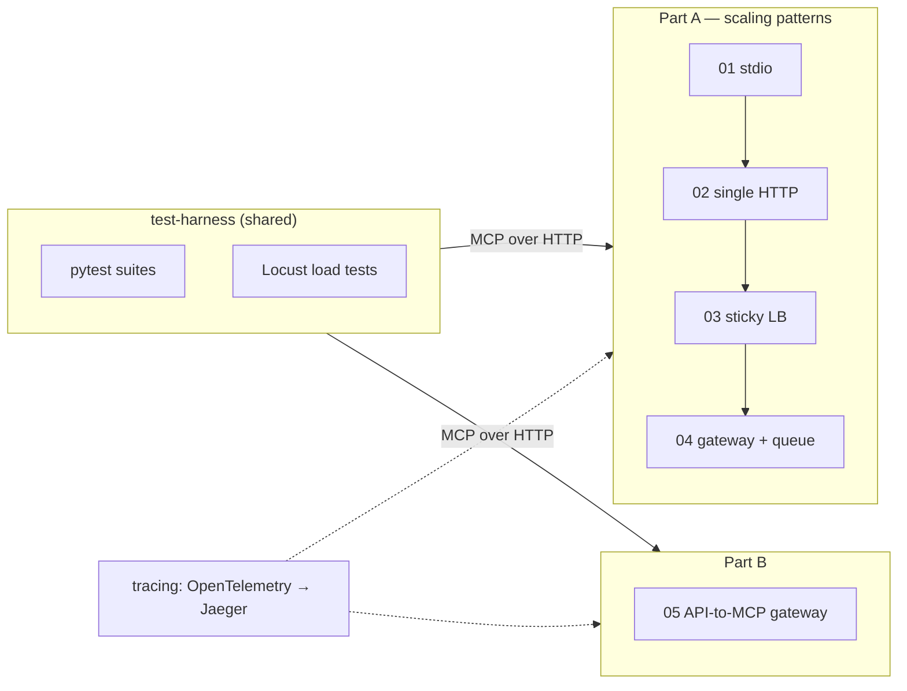
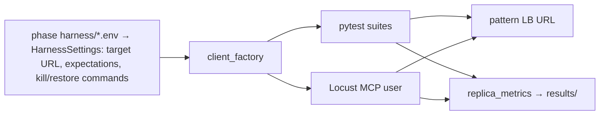
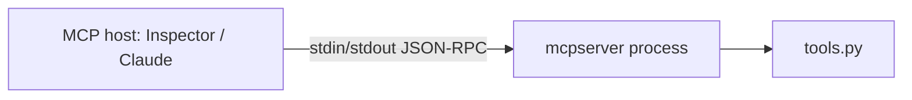
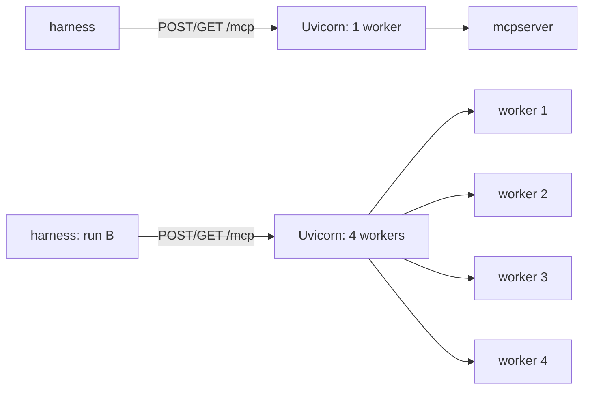
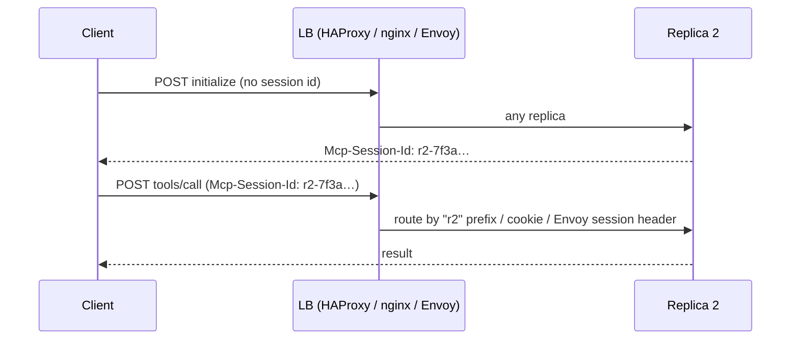
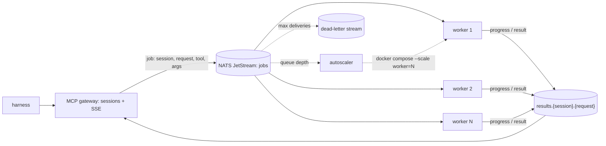
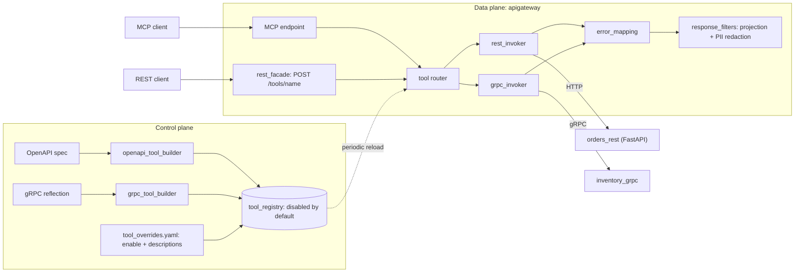
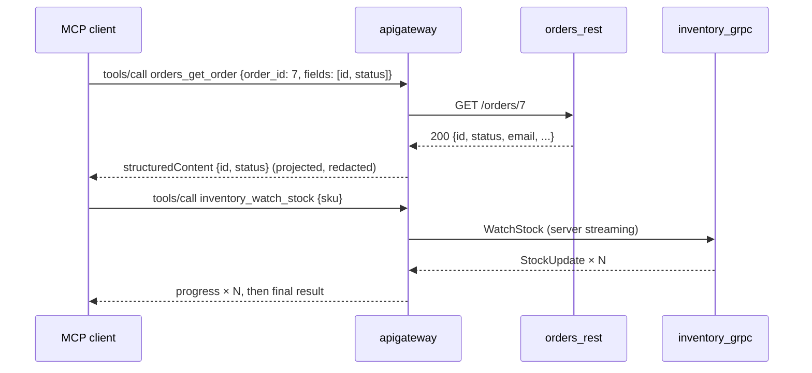
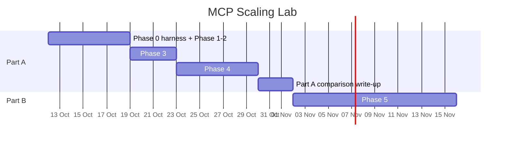

# MCP Scaling Lab — Implementation Plan

| | |
|---|---|
| **Status** | Phases 0–3 done; phases 4–5 planned |
| **Last updated** | 2026-10-06 |
| **Target spec / SDK** | MCP 2025-11-25, Python SDK `mcp` 1.30.0 (pinned per folder) |
| **Runtime** | Docker Compose on Windows (Docker Desktop + WSL2), no Kubernetes |
| **Duration** | about 4.5 weeks (Part A: 2.5 weeks, Part B: 2 weeks) |

---

## 1. Objective

- **Part A:** build one MCP server four times, once per scaling pattern. Measure each version with
  the same test harness and load profile, and finish with a comparison table.
- **Part B:** build an Uber-style gateway that exposes existing REST and gRPC services as MCP tools
  and translates calls in both directions.

### In scope
- Streamable HTTP transport, multi-replica setups on Docker Compose
- Load balancers: nginx, HAProxy, Envoy
- Messaging and state: NATS JetStream (job queue, key-value store for counters)
- REST/gRPC ↔ MCP translation

### Out of scope
Stateless mode behind round robin, shared session stores and pub/sub between peer replicas, Kubernetes / service mesh, serverless,
session-per-container, federation gateways, MCP 2026-07-28
spec (SDK 2.x), multi-region.

---

## 2. Solution overview



**Standard tool set** (identical in folders 01–04, so results are comparable):

| Tool | Behaviour | Measures |
|---|---|---|
| `get_replica_id()` | returns the replica ID (container hostname) | load distribution |
| `increment_counter()` | adds 1 to a per-session counter and returns it | session state survival |
| `run_slow_job(seconds)` | sleeps one second at a time, sends a progress notification each second | long streams, resumability, queue depth |
| `ask_confirmation(question)` | asks the user yes/no via elicitation and returns the answer | server→client round trip |

Each tool is a few lines of code, with no business logic.

---

## 3. Repository structure

```
mcp-scaling-patterns/
├── PLAN.md
├── README.md                         # index + final comparison table
├── ruff.toml                         # shared lint/format rules
├── compose.observability.yaml        # Jaeger (OTLP on 4318, UI on 16686)
├── .gitignore
├── .editorconfig
├── test-harness/
│   ├── pyproject.toml
│   ├── src/mcpharness/
│   │   ├── __init__.py
│   │   ├── config.py                 # HarnessSettings, load_harness_settings()
│   │   ├── constants.py
│   │   ├── client_factory.py         # create_mcp_connection(), open_raw_session()
│   │   ├── scenario_steps.py         # reusable steps: call tool, collect progress, answer elicitation
│   │   ├── raw_protocol.py           # JSON-RPC builders, SSE parsing
│   │   ├── replica_metrics.py        # per-replica distribution, report writer
│   │   └── locust_mcp_session.py     # MCP session on Locust's HTTP client
│   ├── tests/
│   │   ├── conftest.py               # applies each phase's skipped suites / expected failures
│   │   ├── unit/                     # harness self-tests (default pytest run)
│   │   └── suites/                   # run against a server: conformance, distribution,
│   │                                 #   session_affinity, failover, resumability, elicitation
│   └── load/locustfile.py
├── 01-stdio-baseline/
├── 02-streamable-http-single/
├── 03-sticky-session-lb/
├── 04-gateway-queue-workers/
└── 05-api-to-mcp-gateway/
```

**Pattern folder template** (01–04; extra modules are listed in each phase):

```
NN-pattern-name/
├── README.md              # purpose, diagram, run steps, results table
├── pyproject.toml         # deps, pinned mcp version, pytest config
├── .env.example
├── Dockerfile
├── compose.yaml
├── infra/                 # nginx.conf, haproxy.cfg, envoy.yaml (only if the phase needs it)
├── harness/               # *.env files: harness target and expectations for this phase
├── results/               # Locust CSV/HTML, test reports
├── src/mcpserver/
│   ├── __init__.py        # docstring only
│   ├── __main__.py        # entry point
│   ├── app.py             # create_mcp_server(), create_asgi_app()
│   ├── schemas.py         # tool input/output models
│   ├── tools.py           # standard tool set
│   ├── config.py          # ServerSettings (pydantic-settings)
│   └── constants.py
└── tests/
    ├── conftest.py
    └── test_tools.py
```

Folders are self-contained: no Python imports between them. The harness is the only shared
component, and it talks to the servers only over the network.

---

## 4. Engineering standards

Sources: PEP 8, PEP 257, PEP 484, the Python Packaging User Guide, Google Python Style Guide, FastAPI
best practices (zhanymkanov), the Twelve-Factor App, Conventional Commits.

### 4.1 Directory structure
| Rule | Source |
|---|---|
| `src/` layout: importable code under `src/<package>/`, tests outside it in `tests/` | Python Packaging User Guide |
| One `pyproject.toml` per deployable app; it holds dependencies and pytest config | PEP 518/621 |
| Organize by domain/feature, not by file type: no `models/`, `utils/`, `services/` dumping grounds | FastAPI best practices |
| Flat over nested: no folder holding a single module; `__init__.py` holds only a docstring | PEP 20 ("flat is better than nested") |
| Infra config grouped per service inside its pattern folder (`infra/`), not one global infra dir | domain grouping |
| Compose file named `compose.yaml` | Compose specification |
| A local name must never shadow an installed library (`mcpserver/`, not `mcp/`; `nats_client.py`, not `nats.py`) | avoids import bugs |

### 4.2 Naming
| Item | Convention | Example |
|---|---|---|
| Pattern folders | `NN-kebab-case` (not Python packages) | `04-gateway-queue-workers/` |
| Packages | short, lowercase, no underscores | `mcpserver`, `mcpharness`, `apigateway` |
| Modules / files | lowercase `snake_case`, the name says what's inside | `job_publisher.py`, `error_mapping.py` (not `utils.py`, `helpers2.py`) |
| Classes | `CapWords`, nouns | `SessionCounterStore`, `JobPublisher` |
| Functions / methods | `snake_case`, verb first, say what they do | `create_session()`, `publish_job()` |
| Variables | `snake_case`, descriptive, no single letters outside short comprehensions | `session_id`, `replica_count` |
| Constants | `UPPER_SNAKE_CASE`, kept in `constants.py` | `SESSION_ID_HEADER = "mcp-session-id"` |
| Booleans | `is_` / `has_` / `should_` prefix | `is_enabled`, `has_pending_request` |
| Factory prefixes | `create_` makes an object holding a resource (client, app, connection); `build_` assembles a value | `create_nats_client()`, `build_tool_schema()` |
| Settings classes | `<Component>Settings` | `ServerSettings`, `HarnessSettings` |
| Tests | file `test_<subject>.py`, function `test_<behaviour>_<condition>` | `test_counter_survives_replica_kill` |
| Env vars | `UPPER_SNAKE_CASE` with a component prefix | `MCP_REPLICA_ID`, `HARNESS_TARGET_URL` |
| MCP tool names | `snake_case` verbs; translated tools prefixed with the service | `orders_get_order` |

### 4.3 Code
- Type hints on every public function (PEP 484). `mypy --strict` is optional but advised for `src/`.
- Docstrings (PEP 257) on public modules, classes and functions: one-line summary, no restating the
  signature.
- Comments only for a non-obvious *why*; no commented-out code.
- No hard-coded tunables: URLs, timeouts, TTLs, replica counts and limits go in `config.py`
  (pydantic-settings, read from env/`.env`). Fixed strings go in `constants.py`.
- Secrets only in a gitignored `.env`; commit `.env.example` with placeholders.
- No functions nested inside functions; use class methods or module-level functions.
- Small, reusable units: one class per responsibility (store, router, invoker).
- `async` all the way down in the servers. Never block the event loop (CPU work goes through
  `anyio.to_thread`).
- Logging: the `logging` module, structured key/value fields, with `session_id` and `replica_id` on
  every line. No `print`.
- Imports: absolute, from the defining module, sorted by ruff (isort rules).

### 4.4 Tooling and workflow
- **ruff** for lint + format (rule sets `E, F, I, N, UP, B, SIM, ASYNC`), line length 100, in the
  shared `ruff.toml`.
- **pytest** with the anyio plugin (`@pytest.mark.anyio`). Coverage target ≥ 80% on `src/` for unit tests.
- **pre-commit** runs ruff and the unit tests.
- **Git:** one branch per phase, Conventional Commits (`feat(04): add job publisher`), commit after
  each tested unit.
- **CI** (`.github/workflows/ci.yaml`): ruff + unit tests for each folder that changed.

---

## 5. Phases

Each phase: **goal → architecture → deliverables → tasks → acceptance criteria → tests**.

---

### Phase 0 — Test harness and shared setup

**Goal:** a single client-side harness that can run every test suite and load test against any
pattern by URL.



**Deliverables:** `test-harness/` package, `compose.observability.yaml`, root `ruff.toml`,
`.gitignore`, `.editorconfig`, root README.

**Tasks**
- [x] `HarnessSettings` with target URL, expected replica count, skipped suites, expected failures, user counts, durations, kill/restore commands; loaded from the file in `HARNESS_ENV_FILE`
- [x] `client_factory`: SDK sessions and hand-built raw sessions against the LB
- [x] `scenario_steps`: call tool, collect progress events, answer elicitation, run kill/restore commands
- [x] `replica_metrics`: group responses by serving unit, write a Markdown report (latency percentiles come from Locust's CSV)
- [x] Six test suites, each with a pytest marker; strict `xfail` for a phase's expected failures
- [x] Locust `McpUser` with the standard task mix and a `StandardLoadShape` (section 6.3)
- [x] Observability compose: Jaeger with OTLP (Prometheus/Grafana dashboard not built)

**Acceptance criteria:** the harness runs against a stub server; every suite reports pass/fail/skip;
reports are written to `results/`. **Met** — 13 harness unit tests pass; suites ran against phases 2–3.

---

### Phase 1 — `01-stdio-baseline`

**Goal:** reference implementation of the standard tool set over stdio.



**Deliverables:** FastMCP server with the tool set, unit tests, README.

**Tasks**
- [x] Implement the four tools in `tools.py`
- [x] `create_mcp_server()` in `app.py`; stdio entry point
- [x] Unit tests with the SDK in-memory client session, plus a stdio subprocess test
- [ ] Manual check in MCP Inspector (progress and elicitation visible) — left for you; command in the README

**Acceptance criteria:** all tools work in Inspector; unit tests pass; coverage ≥ 80%. **Met except
the manual Inspector check** — 12 tests pass, 100% coverage.

---

### Phase 2 — `02-streamable-http-single`

**Goal:** the same server over Streamable HTTP; establish the single-replica baseline and record the
multi-worker failure.



**Deliverables:** HTTP server, `/healthz`, Dockerfile, `compose.yaml`, baseline load results.

**Tasks**
- [x] Streamable HTTP transport on `/mcp`; `/healthz` route; in-memory event store for resumability; optional OTLP tracing
- [x] Log session create/close with `session_id` (SDK's own log lines)
- [x] Run A: 1 worker, full harness + short load profile
- [x] Run B: 4 workers, harness again; record failures

**Acceptance criteria:** run A passes conformance and affinity; run B fails affinity, and the
failure is documented in the README. **Met** — run A 11 passed / 1 skipped; run B fails affinity
and distribution every run.

---

### Phase 3 — `03-sticky-session-lb`

**Goal:** stateful sessions with session affinity, including routing the first request
(`initialize` has no session ID), plus Envoy resilience features.



**Deliverables:** three affinity variants, Envoy resilience config, failover and rolling-restart
results.

**Extra modules:** `session_id_generator.py` (replica-prefixed IDs); `infra/haproxy.cfg`,
`infra/nginx.conf`, `infra/envoy.yaml`. Graceful shutdown is Uvicorn's `timeout_graceful_shutdown`
plus `stop_grace_period`, so no separate module.

**Tasks**
- [x] Variant A: cookie-based stickiness (HAProxy); the Python SDK client (httpx) keeps cookies
- [x] Variant B: replica-prefixed session IDs + nginx `map`
- [x] Variant C: Envoy stateful-session filter, **envelope** mode (header mode would overwrite `mcp-session-id`)
- [x] Envoy: health checks, outlier detection, retries only on connect failure, no route timeout
- [x] Graceful drain on `SIGTERM` (`stop_grace_period` in Compose)
- [x] Restart during load, graceful stop vs hard kill

**Acceptance criteria:** 1,000-call affinity test passes for all three variants; failover result
documented (sessions lost); drain cuts dropped sessions during a rolling restart. **Partly met** —
affinity and failover met for all three; drain made no measurable difference (23% vs 22% failed
requests), because sessions held in memory are lost either way.

---

### Phase 4 — `04-gateway-queue-workers`

**Goal:** split connection handling (gateway) from tool execution (workers), and autoscale workers
on queue depth.



**Deliverables:** gateway, worker, and autoscaler services; Tasks support; scaling and chaos results.

**Package layout:** `src/mcpqueue/gateway/` (`app.py`, `job_publisher.py`, `result_listener.py`),
`src/mcpqueue/worker/` (`job_consumer.py`, `tool_handlers.py`), `src/mcpqueue/autoscaler/`
(`queue_depth_monitor.py`, `worker_scaler.py`), shared `config.py`, `constants.py`, `job_messages.py`.

**Tasks**
- [ ] Job and result message schemas (pydantic) in `job_messages.py`
- [ ] Gateway publishes jobs, maps worker progress to MCP progress notifications
- [ ] Workers: ack, redelivery, max deliveries → dead-letter; idempotent handlers
- [ ] Session counter in a NATS JetStream key-value bucket keyed by session ID, so any worker can run `increment_counter`
- [ ] Long jobs through MCP Tasks if the pinned SDK supports them; otherwise a job ID + `get_job_status` tool
- [ ] Elicitation, variant A: the worker waits on `answers.{session}.{request}` until the gateway publishes the user's answer
- [ ] Elicitation, variant B: the worker returns `input_required` + saved state; the gateway asks the user and queues a continuation job that any worker can run; compare idle workers and crash behaviour with variant A
- [ ] Gateway uses an in-memory event store (copy `event_store.py` from phase 3; the SDK only defines the interface) so clients can resume progress streams with `Last-Event-ID`
- [ ] Autoscaler: poll depth, scale between min/max with cooldown (all from config)
- [ ] Backpressure: reject or throttle when the queue is above a limit

**Acceptance criteria:** throughput rises as workers scale 1→10; a killed worker's job is redelivered
and completes once; cancel stops the worker; the autoscaler reacts within the configured window;
backpressure returns a clean error; both elicitation variants pass, and variant B survives a worker
kill while waiting for the user.

---

### Phase 5 — `05-api-to-mcp-gateway` (Part B)

**Goal:** expose existing REST and gRPC services as MCP tools with two-way translation, curation,
response filters, and a reverse REST facade (modelled on Uber's MCP Gateway).





**Folder layout**
```
05-api-to-mcp-gateway/
├── compose.yaml
├── tool_overrides.yaml
├── backends/
│   ├── orders_rest/          # FastAPI app, own pyproject + Dockerfile
│   └── inventory_grpc/       # grpcio server, inventory.proto, reflection on
├── src/apigateway/
│   ├── app.py, config.py, constants.py
│   ├── openapi_tool_builder.py
│   ├── grpc_tool_builder.py
│   ├── tool_registry.py
│   ├── rest_invoker.py
│   ├── grpc_invoker.py
│   ├── error_mapping.py
│   ├── response_filters.py
│   ├── discovery_tools.py
│   └── rest_facade.py
└── tests/
    ├── fixtures/             # sample OpenAPI, .proto, expected tool JSON
    └── test_*.py
```

**Tasks**
- [ ] Backends: `orders_rest` (`GET /orders/{id}`, `GET /orders?status=`, `POST /orders`); `inventory_grpc` (`GetStock`, `ReserveStock`, streaming `WatchStock`)
- [ ] OpenAPI → tool: name from `operationId` with service prefix; input schema from path/query/body with `$ref` resolution; output schema from 2xx response; annotations from HTTP method
- [ ] Proto → tool: JSON Schema via the proto3 JSON mapping (int64, enums, oneof, repeated, Timestamp, nested)
- [ ] REST invoker (`httpx`, pooled, timeouts from config); gRPC invoker (`ParseDict` → dynamic `unary_unary` / `unary_stream` → `MessageToDict`)
- [ ] Error mapping: business errors → `isError` result; protocol errors → JSON-RPC error; retries only for read-only tools
- [ ] Pass through `Authorization` and `traceparent` (HTTP headers / gRPC metadata)
- [ ] Registry: tools disabled by default, enabled via `tool_overrides.yaml`, periodic reload
- [ ] Response filters: `fields` projection, configurable PII redaction patterns
- [ ] Many-tools mode: `search_tools`, `get_tool_schema`, `invoke_tool`
- [ ] Reverse facade: `GET /tools`, `POST /tools/{name}`, generated OpenAPI document
- [ ] Optional: LLM-drafted tool descriptions through LangChain (model string in config), written to the overrides file for review
- [ ] Comparison: rebuild the REST part with `FastMCP.from_openapi` (standalone `fastmcp`); document the differences

**Acceptance criteria:** every enabled REST and gRPC operation is callable as an MCP tool and through
the facade; disabled tools never appear in `tools/list`; reload applies within one interval;
gateway p95 overhead recorded.

**Tests (phase-specific)**
| Area | Method |
|---|---|
| Schema conversion | golden-file snapshots: OpenAPI / `.proto` → expected tool JSON |
| Request translation | `respx` mock asserts method, path, query, body; in-process `grpc.aio` server records the decoded request |
| Response translation | `structuredContent` validated against `outputSchema` with `jsonschema` |
| Error mapping | parametrized table: each HTTP status / gRPC code → expected result or JSON-RPC error |
| Curation and reload | new operation appears disabled; enabling it in the overrides shows it after one reload |
| Filters | projection keeps only the requested fields; redaction masks the fixture PII |
| Streaming | `WatchStock` → N progress notifications + final result |
| Reverse facade | parity with the MCP call; Schemathesis fuzzing of the generated OpenAPI |
| Overhead | Locust: direct backend vs via gateway, same profile |

---

## 6. Test strategy

### 6.1 Test levels
| Level | Tool | Target | Gate |
|---|---|---|---|
| Unit | pytest + SDK in-memory client | each folder's `tests/` | pre-commit + CI |
| Conformance | `test_conformance.py` (+ official MCP conformance suite where it covers the target spec) | LB URL | every phase |
| Scaling behaviour | harness suites (6.2) | LB URL | phases 2–4 |
| Load | Locust standard profile (6.3) | LB URL | phases 2–5 |
| Chaos | `docker kill`, `docker restart nats` during load | Compose | phases 3–4 |
| Manual | MCP Inspector | running server | every phase |
| Tracing | OTel → Jaeger: one trace per tool call, tagged with replica | observability stack | phases 2–5 |

### 6.2 Expected results matrix (phases 2–4)
✅ pass · ❌ expected failure (documented) · ⚠ partial · — not applicable

| Suite | 02 (4 workers) | 03 sticky LB | 04 gateway + queue |
|---|---|---|---|
| distribution | — | ⚠ skewed | ✅ (across workers) |
| session affinity (1..1000) | ❌ | ✅ | ✅ (single gateway) |
| failover keeps state | ❌ | ❌ | ✅ (worker kill → redelivery) |
| resumability (`Last-Event-ID`) | ❌ | ⚠ same replica | ⚠ until gateway restart (in-memory) |
| elicitation across replicas / workers | ❌ | ✅ (never crosses) | ✅ (variant B) |

Each folder's README records the actual result next to the expected one.

**Actual (2026-10-06):** 02 four workers — affinity and distribution ❌ every run; resumability and
elicitation pass or fail at random. 03 — distribution ✅ for new sessions (Envoy load share
27/42/31%), affinity ✅, failover ❌, resumability ✅ (client must reconnect again behind HAProxy),
elicitation ✅.

### 6.3 Standard load profile
| Stage | Users | Duration |
|---|---|---|
| Warm-up | 10 | 1 min |
| Steady | 100 | 5 min |
| Spike | 0 → 300 | 30 s ramp |

Task mix: 60% `get_replica_id`, 25% `increment_counter`, 15% `run_slow_job(2)`.
Run at 1, 3 and 6 replicas. Report RPS, p50/p95/p99, error rate and per-replica share in
`results/`, plus one summary row in the root README.

### 6.4 Environment cleanup (after every Docker session)
`docker compose down -v` → stop all containers → quit Docker Desktop → `wsl --shutdown`.

---

## 7. Tech stack

| Concern | Choice |
|---|---|
| Language / MCP | Python 3.11 (local and Docker images), `mcp` 1.30.0 (FastMCP), pinned per folder |
| Env / deps | `python -m venv .venv` + `pip install -e ".[dev]"`, `pyproject.toml` per app |
| Config | `pydantic-settings` + `.env` |
| Load balancers | nginx, HAProxy, Envoy |
| Messaging / state | NATS + JetStream (jobs, results, key-value counters) |
| Orchestration | Docker Compose; autoscaling through the Docker SDK |
| API translation | FastAPI, `grpcio` + reflection, `protobuf` `json_format`, `httpx` |
| Optional LLM | LangChain chat model selected by model string in config |
| Testing | pytest (+ anyio plugin), pytest-cov, respx, jsonschema, Schemathesis, Locust, MCP Inspector |
| Observability | OpenTelemetry → Jaeger |
| Quality | ruff, pre-commit, GitHub Actions |

---

## 8. Schedule



### Definition of done (each phase)
- [ ] README: purpose, Mermaid diagram, run steps, results table
- [ ] ruff clean; unit tests pass; coverage ≥ 80% on `src/`
- [ ] Conformance suite passes
- [ ] Expected-results row (6.2) filled with actual results (phases 2–4)
- [ ] Load results saved in `results/`
- [ ] "When to use this in production" paragraph
- [ ] Committed (Conventional Commit) and environment cleaned up

---

## 9. Risks and mitigations

| Risk | Impact | Mitigation |
|---|---|---|
| Gateway is a single point of failure in phase 4 | sessions lost on gateway restart | documented as a known limit; one gateway is in scope |
| MCP Tasks not supported in the pinned SDK | phase 4 scope | job ID + `get_job_status` tool fallback |
| Client SDKs ignore LB cookies | variant A fails | documented as a finding; variants B/C cover affinity |
| Docker Desktop memory pressure on Windows | flaky load tests | one pattern at a time; limit replicas; cleanup routine (6.4) |
| SDK API changes between minor versions | broken builds | pin exact versions; re-check release notes at each phase start |
| Proto/OpenAPI edge cases (recursive schemas, `oneOf`) | phase 5 schema bugs | golden-file fixtures for each edge case before implementing |

| No public SDK hook for session ID generation (phase 3) | prefix routing breaks on upgrade | override pinned to mcp 1.30.0; unit test fails if it breaks |

---

## 10. Open items from phases 0–3
| Item | Status |
|---|---|
| Manual MCP Inspector check (phase 1) | not done |
| Full 7-minute load profile, and 1/3/6 replica runs | only a short profile (~1 min) was run |
| Prometheus + Grafana "requests per replica" dashboard | not built; Jaeger tracing only |
| Structured logging with `session_id` / `replica_id` on every line (4.3) | servers use the SDK's default logging |
| pre-commit, CI workflow, git commits per phase (4.4) | not set up; the folder is not a git repository |

---

## 11. References
- MCP specification — https://modelcontextprotocol.io/specification
- MCP Python SDK — https://github.com/modelcontextprotocol/python-sdk
- Uber, *Designing the MCP Gateway* — https://www.uber.com/us/en/blog/designing-mcp-gateway/
- Envoy AI Gateway, MCP — https://aigateway.envoyproxy.io/docs/capabilities/mcp/
- Proto3 JSON mapping — https://protobuf.dev/programming-guides/json/
- PEP 8 — https://peps.python.org/pep-0008/
- PEP 257 — https://peps.python.org/pep-0257/
- PEP 484 — https://peps.python.org/pep-0484/
- src vs flat layout — https://packaging.python.org/en/latest/discussions/src-layout-vs-flat-layout/
- Google Python Style Guide — https://google.github.io/styleguide/pyguide.html
- FastAPI best practices — https://github.com/zhanymkanov/fastapi-best-practices
- Twelve-Factor App, config — https://12factor.net/config
- Conventional Commits — https://www.conventionalcommits.org/
