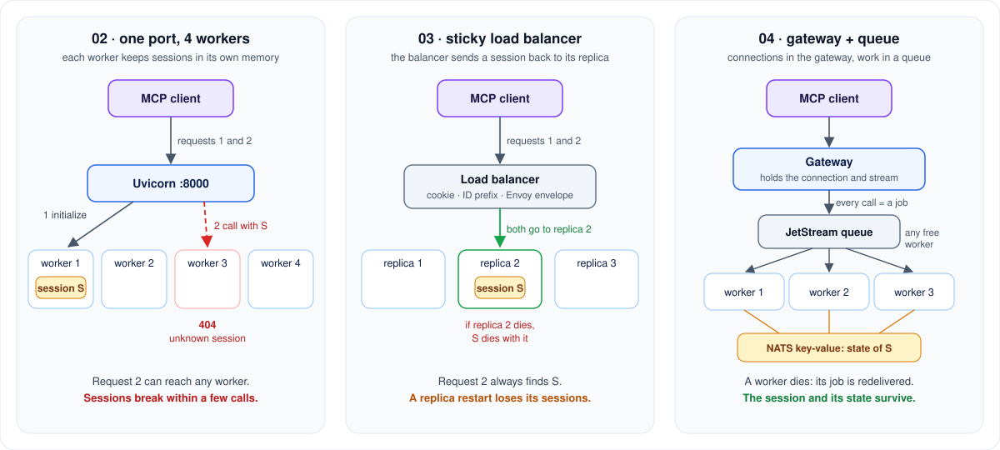
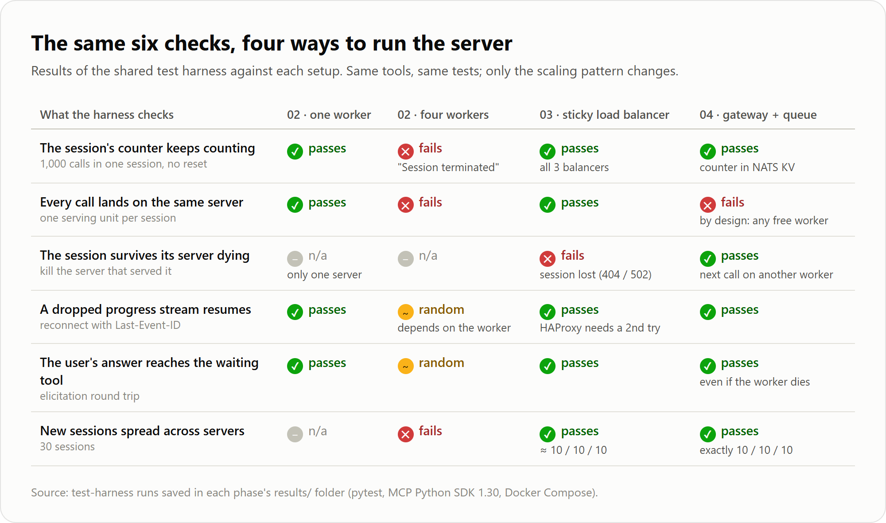
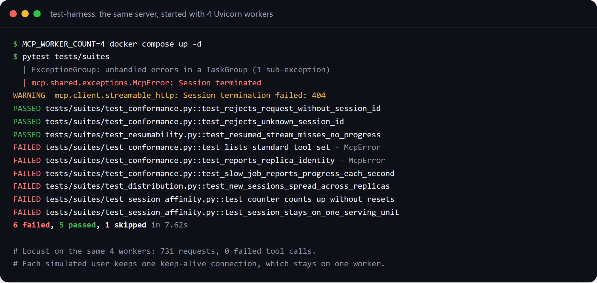
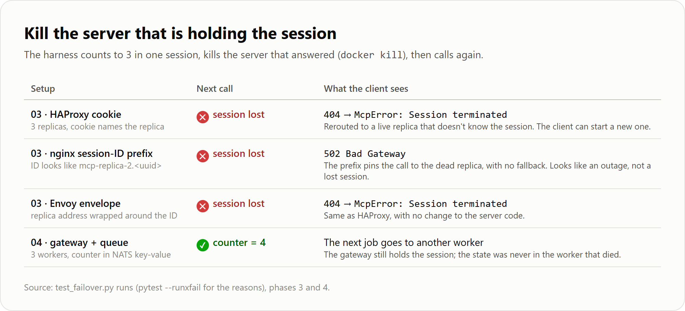
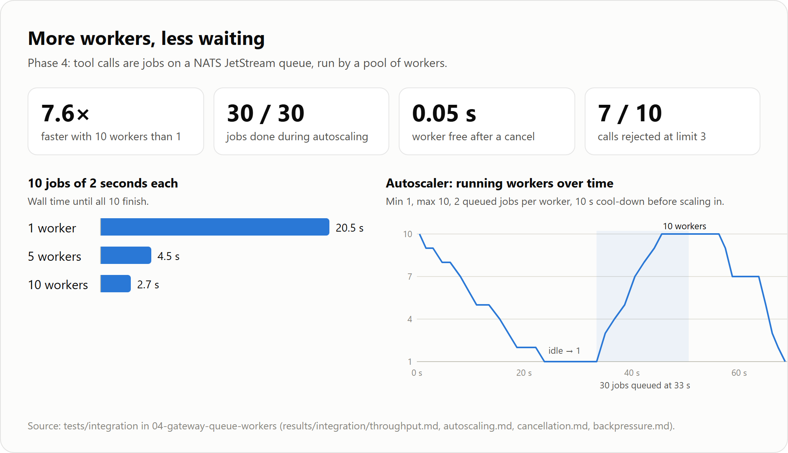
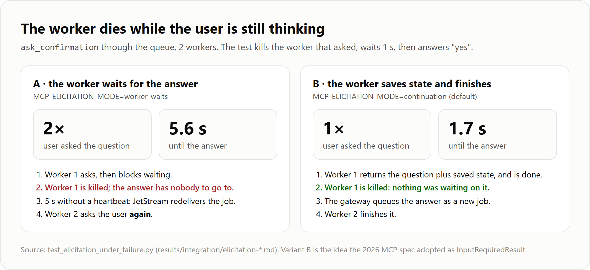
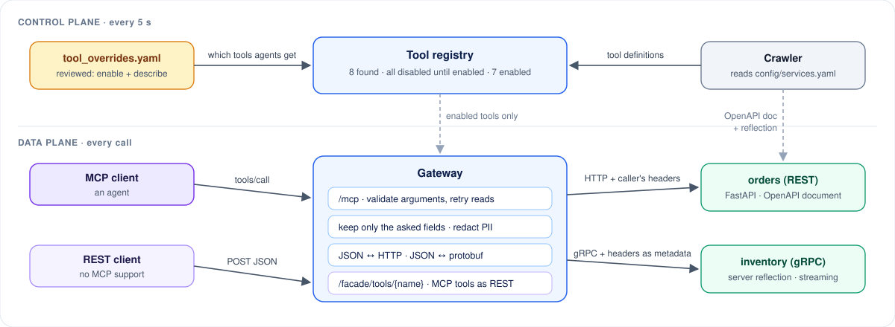
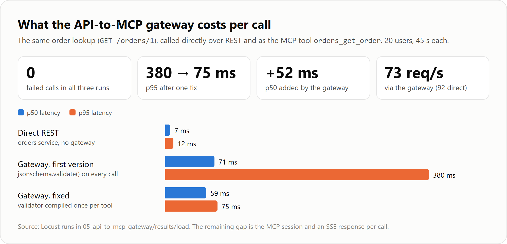
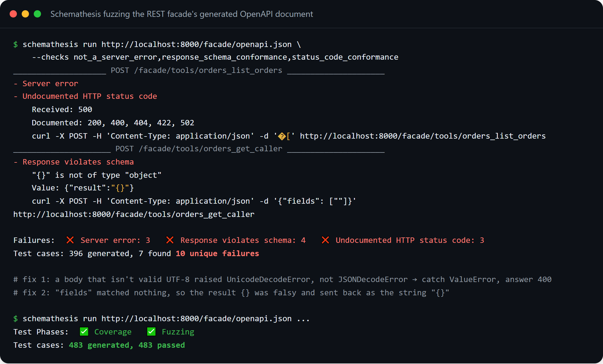
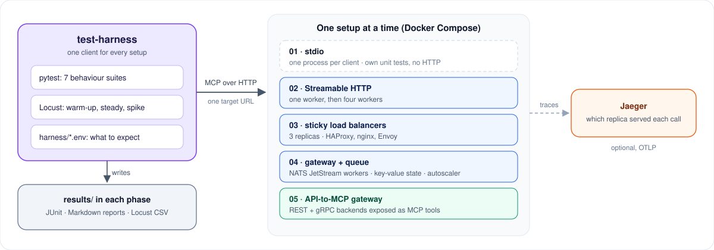

# MCP Scaling Lab

[](./LICENSE)

What happens to an MCP server when you run more than one copy of it? This lab answers that by
building the same small server several ways, from one process to a load-balanced pool to a
gateway with a job queue, and running the exact same tests against each one.

---

## The problem

Your MCP server works fine on your laptop. Then it has to handle real traffic, so you do the
obvious thing: start four workers instead of one, or put three copies behind a load balancer.

And it starts failing, but only sometimes:

- *A tool call fails with `Session terminated`.* The same call worked a second ago.
- *A long job reports progress, then goes quiet.* The client never gets the result.
- *The tool asks the user a question, the user answers, and nothing happens.*
- *Your load test says everything is fine.* 731 requests, zero failures.

The reason: an MCP session over Streamable HTTP (the 2025 spec) is **stateful**. The first
request (`initialize`) gets a session ID, and that session lives in the memory of **one**
process. Progress streams and "ask the user" requests wait inside that same process. When
request 2 reaches a different copy, that copy has never heard of the session.

## What this lab does

It builds the same four-tool server five ways and measures each one:

- 🧪 **One test harness for every setup.** Seven checks: does the session's counter keep
  counting, does every call land on the same server, does the session survive its server dying,
  does a dropped stream resume, does the user's answer reach the waiting tool, do new sessions
  spread out, and does the server follow the protocol.
- 💥 **Phase 2 shows the bug.** One worker passes; four workers break within a few calls.
- 📌 **Phase 3 pins sessions** with three load balancers: an HAProxy cookie, an nginx route on
  the session ID, and Envoy's envelope mode.
- 📬 **Phase 4 moves the work, not the session.** A gateway holds every connection; tool calls
  become jobs on a NATS JetStream queue; state lives in a key-value store, so any worker can die.
  An autoscaler adds workers when the queue grows.
- 🔌 **Phase 5 turns existing REST and gRPC services into MCP tools**, the way Uber's MCP
  gateway does: discovered automatically, hidden until a reviewed file enables them.
- 📊 **Every number is measured**, and the raw results are saved in each phase's `results/`.

---

## Example: why four workers break an MCP server

Request 1 creates the session in one worker's memory. Request 2 can reach any of the four.
Each phase answers the same question differently: *how does request 2 find what request 1
created?*

<p align="center">
  
</p>

- **02, four workers:** nothing routes request 2, so it lands on a random worker.
- **03, sticky load balancer:** the balancer remembers where the session lives. It works until
  that replica restarts.
- **04, gateway + queue:** the gateway keeps the connection, and the state lives outside every
  worker. Workers become interchangeable.

---

## Results

Everything below comes from real runs on Docker Desktop (Windows, MCP Python SDK 1.30).

### 1. The scorecard

The same harness against each setup. Nothing changes but the scaling pattern.

<p align="center"></p>

### 2. What four workers do to a real client

The MCP SDK client opens several connections at once (requests plus a background stream), so a
session's requests land on different workers and get `404 Session terminated`. The load test on
the same setup showed 0 failed tool calls, because each simulated user sends everything over one
keep-alive connection, and a connection stays on one worker. **A load test alone would have
called this setup healthy.**

<p align="center"></p>

### 3. When the server holding the session dies

Sticky routing loses the session with every balancer; only the error differs. A `404` tells an
MCP client to start a new session. nginx's `502` looks like an outage instead. The gateway with
a queue is the first setup where the next call simply continues.

<p align="center"></p>

### 4. Scaling the work, not the connections

With tool calls on a queue, adding workers adds capacity directly: 10 jobs of 2 seconds took
20.5 s with one worker and 2.7 s with ten. The autoscaler grows the pool from 1 to 10 when 30
jobs arrive and shrinks it after a cool-down.

<p align="center"></p>

The trade-off: each worker runs one job at a time, so quick calls queue behind slow ones. Under
the mixed load test, `get_replica_id` took 1.6 s at p50 instead of 55 ms.

### 5. Asking the user a question when workers can die

`ask_confirmation` built two ways, with the asking worker killed while the user thinks. If the
worker waits for the answer, the job is redelivered and the user is asked **twice**. If the
worker saves its state and finishes, the answer becomes a new job for any worker, and the user
is asked **once**.

<p align="center"></p>

### 6. Existing REST and gRPC services as MCP tools

The control plane reads the orders service's OpenAPI document and the inventory service's gRPC
reflection, and lists 8 operations. All stay hidden until `tool_overrides.yaml` enables them.
The data plane translates each call, keeps only the fields the agent asked for, masks emails
and phone numbers, and forwards the caller's `Authorization` and `traceparent` headers. The
same tools are also served as plain REST.

<p align="center"></p>

Through the gateway, the same order lookup costs about 52 ms more at p50 than calling REST
directly. The first version was much slower: it re-checked every tool's JSON Schema on every
call. Compiling each validator once cut p95 from 380 ms to 75 ms.

<p align="center"></p>

### 7. Fuzzing found two real bugs

Schemathesis generated requests from the REST facade's OpenAPI document. It found a 500 on a
body that isn't valid UTF-8, and an empty result `{}` sent back as the string `"{}"`. After the
fixes: 483 generated cases, 483 passed.

<p align="center"></p>

---

## Architecture

<p align="center">
  
</p>

- **Test harness:** the client side. The same pytest suites and Locust load profile run against
  any setup by URL. A small settings file per setup says which checks should pass and which
  failures are expected, so an expected failure shows up as `XFAIL` instead of red.
- **The setups:** five folders, each a complete project with its own `pyproject.toml`, tests,
  Dockerfile and `compose.yaml`. They share no code; only the harness talks to all of them.
- **Jaeger (optional):** servers can send a trace per request, tagged with the session, to show
  which replica answered each call.

---

## Concepts used

| Concept | In plain words |
|---|---|
| **MCP session (Streamable HTTP)** | The first request gets an `Mcp-Session-Id`; later requests send it back. The session lives in one server process's memory. |
| **Sticky sessions** | The load balancer sends every request of a session to the same copy: by a cookie, by a replica name inside the session ID, or by Envoy wrapping the replica address around the ID. |
| **Resumable streams** | Progress events get IDs. A client whose connection dropped reconnects with `Last-Event-ID` and receives what it missed. |
| **Elicitation** | A tool pauses to ask the user something. The server has to get the answer back to the exact call that is waiting. |
| **Work queue (NATS JetStream)** | Each tool call becomes a job. A free worker takes it, sends heartbeats while it runs, and acknowledges it when done. A job from a worker that died is handed to another one. |
| **Shared state (key-value)** | The session's data lives outside the workers, so it doesn't matter which worker runs the next call. |
| **Autoscaling on queue depth** | More waiting jobs means more workers; idle workers are stopped after a cool-down. |
| **Backpressure** | When the queue is full, new calls get a clear "retry later" error instead of waiting forever. |
| **Tool curation** | Discovering an operation doesn't expose it. A person enables each tool in a reviewed file, and the change applies without a restart. |
| **Protocol translation** | MCP's JSON arguments become an HTTP request or a protobuf message, and the reply comes back as JSON. |
| **Expected failures** | Some checks are *supposed* to fail for some setups. The harness marks them so the failure documents the lesson instead of hiding it. |

---

## Results so far

| Phase | Measurement |
|---|---|
| 02 · four workers | counter and spread checks fail on every run; load test shows 0 failed tool calls |
| 03 · sticky load balancers | 1,000-call counter passes on all three; a replica kill loses the session (404 or 502) |
| 03 · graceful vs hard restart | 23% vs 22% failed requests: draining doesn't save in-memory sessions |
| 04 · gateway + queue | survives a worker kill; 20.5 s → 2.7 s from 1 to 10 workers; 1 → 10 workers in ~12 s |
| 04 · elicitation | user asked once (variant B) instead of twice (variant A) when the worker dies |
| 05 · API-to-MCP gateway | 7 of 8 discovered tools enabled; reload in 4.8 s; +52 ms p50 per call |
| 05 · fuzzing | 2 bugs found and fixed; 483 / 483 cases pass |

---

## Run it locally

### Prerequisites

- Python 3.11+ and Docker Desktop
- Windows PowerShell commands below; on macOS/Linux use `.venv/bin/python` instead of
  `.\.venv\Scripts\python.exe`

### 1. Install

```powershell
git clone <this repository>
cd mcp-scaling-patterns\test-harness
python -m venv .venv
.\.venv\Scripts\python.exe -m pip install -e ".[dev]"
```

Each phase folder is installed the same way when you want its unit tests.

### 2. Start one setup and test it

```powershell
cd ..\03-sticky-session-lb
docker compose up -d --build            # 3 replicas + HAProxy :8081, nginx :8082, Envoy :8083

cd ..\test-harness
$env:HARNESS_ENV_FILE = "../03-sticky-session-lb/harness/cookie-haproxy.env"
.\.venv\Scripts\python.exe -m pytest tests/suites -rxX
.\.venv\Scripts\locust.exe -f load/locustfile.py --headless --only-summary
```

Swap the folder and the settings file for any other setup:

| Setup | Start | Harness settings |
|---|---|---|
| 02 · one / four workers | `docker compose up -d --build` (`$env:MCP_WORKER_COUNT="4"` for four) | `harness/single-worker.env`, `harness/four-workers.env` |
| 03 · sticky load balancers | `docker compose up -d --build` | `harness/cookie-haproxy.env`, `prefix-nginx.env`, `envelope-envoy.env` |
| 04 · gateway + queue | `docker compose up -d --build --wait` | `harness/gateway.env` |
| 04 · with autoscaler | `$env:WORKER_REPLICAS="10"; docker compose --profile autoscale up -d --wait` | `harness/gateway.env` |
| 05 · API-to-MCP gateway | `docker compose up -d --build --wait` | `harness/gateway.env` (protocol checks only) |

Phases 4 and 5 also have their own Docker-driven tests:
`.\.venv\Scripts\python.exe -m pytest tests/integration -m integration --no-cov`.

### 3. Clean up

```powershell
docker compose down
```

Then quit Docker Desktop. On Windows, also run `wsl --shutdown` to free the memory.

### Calling the tools by hand

Run `npx @modelcontextprotocol/inspector` and connect with Streamable HTTP to the setup's URL,
for example `http://localhost:8000/mcp`. Phase 1 runs over stdio: from `01-stdio-baseline`,
`npx @modelcontextprotocol/inspector .\.venv\Scripts\python.exe -m mcpserver`.

---

## Which pattern when?

| You need | Use |
|---|---|
| A local tool for one user | stdio (01) |
| Small traffic; losing sessions on a restart is fine | one replica, one worker (02) |
| Stateful features (progress, elicitation) on several replicas | a sticky load balancer that answers `404` on failover (03, HAProxy or Envoy) |
| Slow or heavy tools, retries, scaling compute on its own | gateway + queue + workers (04) |
| Many existing services that agents should use safely | an API-to-MCP gateway with curation (05) |

Never run a stateful MCP server with several Uvicorn or Gunicorn workers behind one port.
The 2026-07-28 MCP spec removes sessions from the protocol, which makes most of phases 3 and 4
unnecessary for new servers. Most clients still speak the 2025 spec, and it stays supported
until July 2027.

---

## Project structure

```text
mcp-scaling-patterns/
├── test-harness/              the client side: pytest suites, Locust profile, raw-protocol helpers
│   ├── src/mcpharness/        config, client factory, scenario steps, replica metrics
│   ├── tests/suites/          the seven behaviour checks, one pytest marker each
│   └── load/                  Locust user + load shape
├── 01-stdio-baseline/         the four tools over stdio
├── 02-streamable-http-single/ HTTP, event store for resumability, optional tracing
├── 03-sticky-session-lb/      replica-prefixed session IDs + infra/ (haproxy, nginx, envoy)
├── 04-gateway-queue-workers/  src/mcpqueue/{gateway,worker,autoscaler}/
├── 05-api-to-mcp-gateway/     src/apigateway/, backends/ (orders REST, inventory gRPC), config/
├── docs/                      images/ for this README, image-sources/ to regenerate them
├── compose.observability.yaml Jaeger
└── PLAN.md, ruff.toml, LICENSE
```

Every phase folder has the same shape: `README.md`, `pyproject.toml`, `Dockerfile`,
`compose.yaml`, `src/`, `tests/`, `harness/` and `results/`.

---

## Tests

- **Unit tests in every folder**, using the MCP SDK's in-memory client: no network, no Docker.
  Each folder enforces 80% coverage; actual coverage is 97–100%.
- **The harness suites** run against a live setup over HTTP, with expected failures marked.
- **Docker-driven integration tests** in phases 4 and 5 kill workers, fill the queue, edit the
  overrides file, and fuzz the REST facade.
- **Golden files** in phase 5 pin the generated tool schemas; `UPDATE_SNAPSHOTS=1` refreshes them.

---

## Documentation

| Topic | What's in it |
|---|---|
| [test-harness](./test-harness/README.md) | The checks, settings files, expected failures, load profile |
| [01 · stdio baseline](./01-stdio-baseline/README.md) | The four tools, over stdio |
| [02 · Streamable HTTP](./02-streamable-http-single/README.md) | One worker vs four, and why load tests hide the bug |
| [03 · sticky load balancers](./03-sticky-session-lb/README.md) | Cookie, ID prefix and Envoy envelope, failover, restarts |
| [04 · gateway + queue](./04-gateway-queue-workers/README.md) | Jobs, heartbeats, redelivery, cancel, backpressure, autoscaling |
| [05 · API-to-MCP gateway](./05-api-to-mcp-gateway/README.md) | Discovery, curation, translation, filters, REST facade, comparison with FastMCP |
| [PLAN.md](./PLAN.md) | Phases, tasks, acceptance criteria, open items |

## License

MIT, see [LICENSE](./LICENSE).
