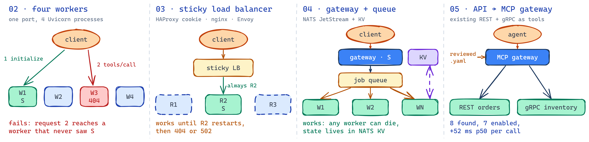

# MCP Scaling Lab

AI agents call tools through MCP servers, and in production those servers
get scaled like any web service: more workers, a load balancer, an autoscaler. That breaks them,
because an MCP session lives in one process's memory. I built the same MCP server five ways and
tested each under the same failures and load to find which architecture actually holds up.

**What it shows:**
- **Distributed-systems design:** sticky routing (HAProxy, nginx, Envoy), a job queue with shared
  state (NATS JetStream + KV), redelivery, backpressure and autoscaling.
- **Testing that finds real failures:** one harness kills replicas and checks every setup; it
  caught a bug that a load test reported as 0 failures.
- **Agent platform work:** a gateway that turns existing REST and gRPC APIs into curated MCP tools,
  modelled on Uber's MCP gateway.



## Results

Same harness, same checks; only the scaling pattern changes.


| Pattern | Key result |
|---|---|
| 02 · four workers | `404 Session terminated` within a few calls, while the load test showed 0 failures |
| 03 · sticky load balancer | 1,000-call counter passes on HAProxy, nginx and Envoy; a replica restart loses its sessions |
| 04 · gateway + queue | survives a worker kill; 10 jobs: 20.5 s → 2.7 s from 1 to 10 workers; autoscales 1 → 10 in ~12 s |
| 05 · API-to-MCP gateway | 8 REST/gRPC operations discovered, 7 enabled by review; +52 ms p50; fuzzing found 2 bugs |

## Phases

| Phase | What it shows |
|---|---|
| [01 · stdio](./01-stdio-baseline/README.md) | Baseline: four tools over stdio |
| [02 · Streamable HTTP](./02-streamable-http-single/README.md) | One worker works; four break; load tests hide it |
| [03 · sticky load balancers](./03-sticky-session-lb/README.md) | HAProxy cookie, nginx session-ID routing, Envoy stateful session |
| [04 · gateway + queue](./04-gateway-queue-workers/README.md) | NATS JetStream jobs, KV state, redelivery, cancel, backpressure, autoscaler |
| [05 · API-to-MCP gateway](./05-api-to-mcp-gateway/README.md) | OpenAPI + gRPC discovery, reviewed curation, PII masking, REST facade |
| [test-harness](./test-harness/README.md) | Seven behaviour checks + Locust load, run against any phase by URL |

**Stack:** Python 3.11, MCP Python SDK, Docker Compose, NATS JetStream, HAProxy, nginx, Envoy,
gRPC, pytest, Locust, Schemathesis, OpenTelemetry/Jaeger.

## Which pattern when?

| You need | Use |
|---|---|
| A local tool for one user | stdio (01) |
| Stateful features on several replicas | a sticky load balancer that answers `404` on failover (03) |
| Slow or heavy tools, retries, compute that scales on its own | gateway + queue + workers (04) |
| Existing services exposed safely to agents | an API-to-MCP gateway with curation (05) |

Never run a stateful MCP server with several Uvicorn workers behind one port. The 2026-07-28 MCP
spec removes sessions, which makes most of phases 3–4 unnecessary for new servers once clients
move to it.

## Quick start

```powershell
cd 03-sticky-session-lb; docker compose up -d --build
cd ..\test-harness; python -m venv .venv; .\.venv\Scripts\python.exe -m pip install -e ".[dev]"
$env:HARNESS_ENV_FILE = "../03-sticky-session-lb/harness/cookie-haproxy.env"
.\.venv\Scripts\python.exe -m pytest tests/suites -rxX
```

Each phase README has its own run steps, settings files and raw results.

## License

MIT, see [LICENSE](./LICENSE).
