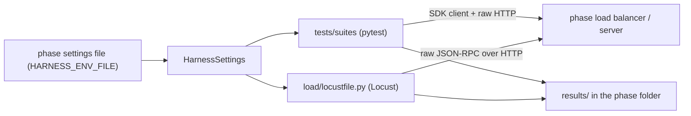

# test-harness — Phase 0

One client-side harness for every phase: pytest suites that check scaling behaviour, and a Locust
load profile. It talks to servers only over HTTP.



## Layout
| Path | Contents |
|---|---|
| `src/mcpharness/config.py` | `HarnessSettings`, `load_harness_settings()` |
| `src/mcpharness/client_factory.py` | `create_mcp_connection()` (SDK client), `open_raw_session()` |
| `src/mcpharness/scenario_steps.py` | tool-call steps, progress collector, elicitation responder, kill/restore commands |
| `src/mcpharness/raw_protocol.py` | JSON-RPC message builders, SSE parsing |
| `src/mcpharness/replica_metrics.py` | `ReplicaDistribution`, Markdown report writer |
| `src/mcpharness/locust_mcp_session.py` | MCP session on Locust's HTTP client |
| `tests/unit/` | tests of the harness itself (default `pytest` run, no server needed) |
| `tests/suites/` | suites run against a server, one pytest marker each |
| `load/locustfile.py` | `McpUser` (60/25/15 task mix) and `StandardLoadShape` |

## Suites
| Marker | Checks |
|---|---|
| `conformance` | tool list, replica identity, progress, `400` without session, `404` unknown/deleted session |
| `distribution` | 30 new sessions spread across the expected number of serving units |
| `affinity` | counter goes 1..N with no reset; every call answered by one serving unit |
| `failover` | kill the replica holding the session; does the counter continue? |
| `resumability` | drop the stream after the first progress event, resume with `Last-Event-ID` |
| `elicitation` | the user's answer reaches the waiting `ask_confirmation` call |

Each phase folder has `harness/*.env` files. `HARNESS_SKIPPED_SUITES` skips suites that don't
apply; `HARNESS_EXPECTED_FAILURES` marks suites as strict `xfail`, so an expected failure shows as
`XFAIL` and an unexpected pass fails the run.

## Run
```powershell
python -m venv .venv; .\.venv\Scripts\python.exe -m pip install -e ".[dev]"
.\.venv\Scripts\python.exe -m pytest --cov=mcpharness          # harness unit tests

$env:HARNESS_ENV_FILE="../03-sticky-session-lb/harness/cookie-haproxy.env"
.\.venv\Scripts\python.exe -m pytest tests/suites -rxXs        # all suites
.\.venv\Scripts\python.exe -m pytest tests/suites -m affinity  # one suite
.\.venv\Scripts\locust.exe -f load/locustfile.py --headless --only-summary --csv <phase>/results/<name>/load
```
Settings are JSON for list values (`HARNESS_EXPECTED_FAILURES=["failover"]`). Any `HARNESS_*`
environment variable overrides the file, e.g. `HARNESS_LOAD_STEADY_SECONDS=30` for a short run.

## Results (2026-10-06)
13 unit tests pass, ruff clean. Suites were run against phases 2 and 3; see their READMEs.
